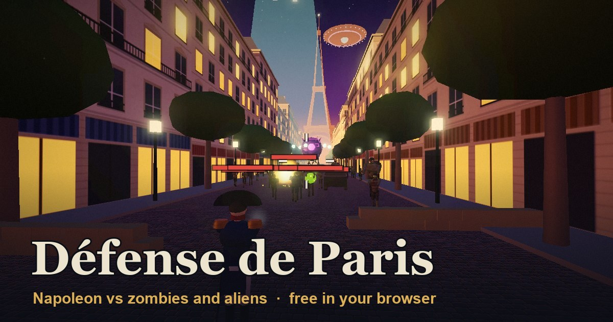

# Défense de Paris

**Play it free in your browser: https://skriptkiddy98x.github.io/defense-de-paris/**



Zombies are pouring through the avenues of Paris and an alien mothership hangs over the Eiffel Tower. Pick Napoleon or a medieval crusader, take three AI squadmates and hold Place de la Concorde wave after wave.

Works on desktop (keyboard and mouse) and on phones and tablets (touch controls, portrait or landscape). No download, no account.

## Features

- **Two heroes.** Napoleon calls in an artillery strike and makes his squad hit harder. The Crusader wears chain mail, swings a longsword and unleashes Holy Wrath, a shockwave that throws everything back.
- **Weapons.** FAMAS rifle, FR-F2 sniper that pierces three enemies, flamethrower, grenades and melee.
- **Enemies.** Walkers, runners, brutes, bloaters that burst into chain reactions, alien troopers that beam down and shoot from range, and the Invasion Commander boss every fifth wave.
- **Upgrades.** After every wave, pick one of three upgrades. There are 15 and they stack, so every run builds differently.
- **Kill streaks.** Kills less than three seconds apart build a streak that multiplies your points, from Double kill to Légendaire.
- **Pickups and power-ups.** Health, ammo and grenades, plus Insta-Kill, Double Points, Rage, Max Ammo and the Nuke.
- **Ranks and sharing.** Every run ends with a rank from Conscript to Emperor of Paris and a button to share your score.

## Controls

| Desktop | Touch |
| --- | --- |
| W A S D to move, Shift to sprint | Left thumb moves, push to the edge to sprint |
| Mouse to aim, left button to fire | Drag with the right thumb to aim, hold Fire |
| Right button for sights and scope | Aim button |
| 1 2 3 or wheel: rifle, sniper, flamethrower | Tap 1 2 3 |
| R reload · G grenade · V melee · Q hero ability | Reload, Nade, Melee and Ability buttons |
| Hold E to revive a squadmate | Stand next to them |
| Enter starts the next wave early · M music · Esc pause | Start wave now · II pause |

## Tech

Three.js r128 with bloom and a custom colour-grading pass. Every character, building, texture and sound is generated in code: there are no image, model or audio files besides the icon and preview picture. Characters are baked into skinned meshes and the city into merged meshes to keep draw calls low, and graphics quality steps down automatically on slower GPUs.

To run it locally, serve this folder with any static web server, for example:

```bash
python -m http.server 8000
```

Then open http://localhost:8000.

## Privacy

On the published site the game bumps a few anonymous counters at [Abacus](https://abacus.jasoncameron.dev) (page opened, game started, first game on this device, waves 5 and 10 reached). It sends no cookies, IDs or player data, and nothing is counted when you run it locally.
